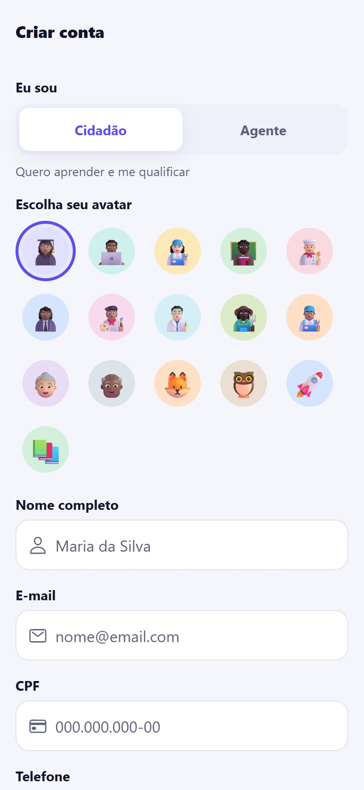
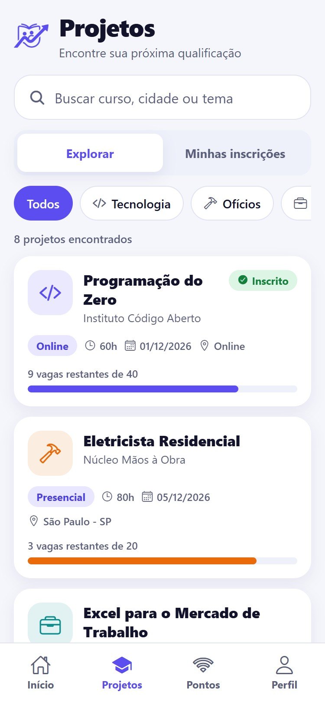
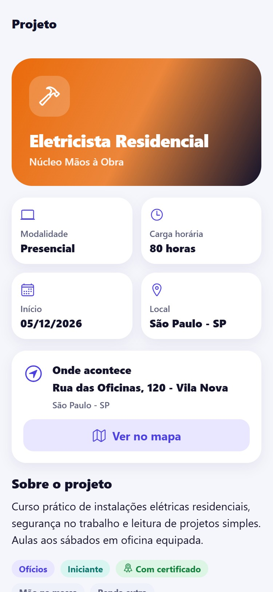
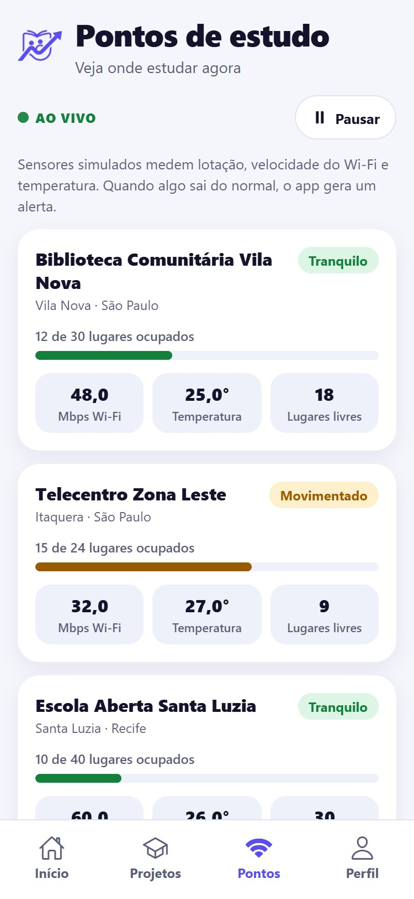
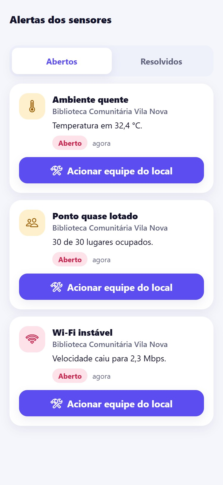
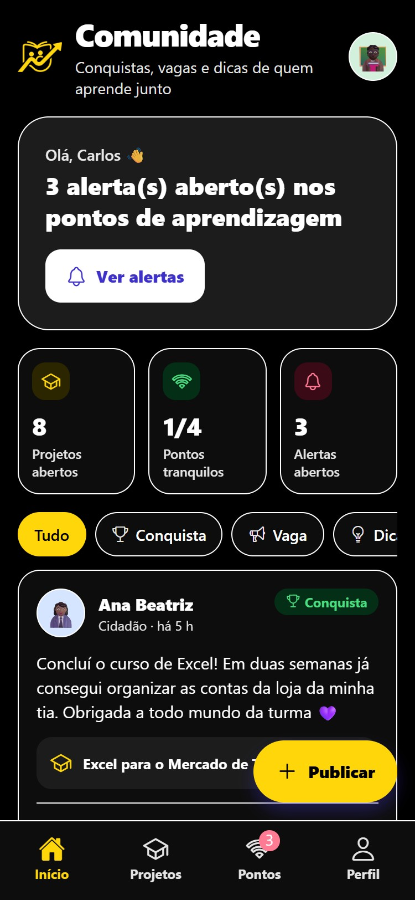
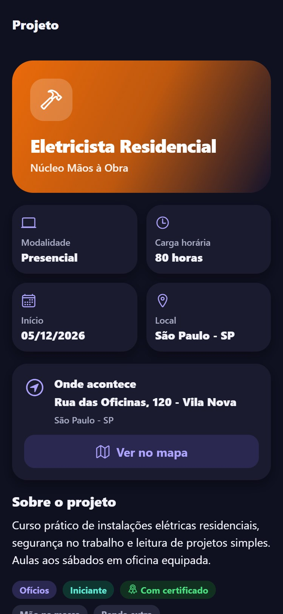

# Trilhar · rede de educação e qualificação

> **Aprender é melhor junto.** O Trilhar conecta cidadãos que buscam qualificação a projetos de educação, a uma comunidade que se ajuda e a pontos de estudo com Wi-Fi e lugar livre — tudo no celular.

App em **React Native (Expo)** desenvolvido para a atividade **CitizenTech**.

---

## 1. Ficha da CitizenTech

| | |
|---|---|
| **Nome da CitizenTech** | Trilhar |
| **Cidade e bairro** | São Paulo, Zona Sul (Capão Redondo, Campo Limpo, Jardim Ângela) |
| **Link do repositório** | https://github.com/ramalhoalexia/Trilhar_2GS26 |

### Problema

Muita gente quer se qualificar, mas **não sabe que projetos existem perto de si**: as iniciativas de educação comunitária ficam **espalhadas** (cada ONG, escola, biblioteca e telecentro divulga em um canal diferente). Quem estuda fora de casa ainda **chega ao local e encontra tudo lotado ou sem internet**. Do outro lado, quem organiza os projetos tem dificuldade de alcançar o público e de saber quando um espaço está com problema.

### Público beneficiado

- **Cidadãos** em busca de qualificação profissional, retomada dos estudos ou inclusão digital: jovens no primeiro emprego, adultos em transição de carreira e pessoas 50+ que estão aprendendo a usar o celular.
- **Agentes**: educadores, ONGs, coletivos, bibliotecas, telecentros e escolas abertas que oferecem os projetos e mantêm os pontos de aprendizagem.

### Hipóteses

| # | Hipótese | Indicador que a testa |
|---|----------|------------------------|
| H1 | Reunir os projetos em um só lugar aumenta as inscrições de pessoas que antes não os encontravam. | Taxa de inscrição |
| H2 | Ver conquistas de pessoas parecidas aumenta a motivação para concluir o curso. | Taxa de conclusão e engajamento |
| H3 | Mostrar lotação e qualidade do Wi-Fi em tempo real reduz viagens perdidas até um ponto de estudo. | Reservas por ponto |
| H4 | Alertas automáticos dos sensores reduzem o tempo entre o problema acontecer e a equipe agir. | Tempo de resposta a alertas |
| H5 | Divulgar as vagas pelo app ajuda os agentes a preencher as turmas. | Vagas ocupadas |

### Indicadores

| Indicador | Como medir | Meta inicial |
|-----------|-----------|--------------|
| Taxa de inscrição | inscrições ÷ visualizações de projeto | ≥ 20% |
| Taxa de conclusão | inscritos que chegam a 100% de progresso | ≥ 40% |
| Engajamento na comunidade | publicações, curtidas e comentários por usuário/semana | ≥ 3 |
| Reservas por ponto | reservas confirmadas por ponto/dia | crescimento semanal |
| Tempo de resposta a alertas | do alerta aberto até o status "em atendimento" | < 15 min |
| Vagas ocupadas | inscritos ÷ vagas ofertadas | ≥ 70% |

### Como funciona

O cidadão entra no app, encontra projetos por busca e categoria, inscreve-se com um toque e acompanha o progresso. Na comunidade, compartilha conquistas, dúvidas e dicas. Na aba Pontos, vê ao vivo a lotação, o Wi-Fi e a temperatura dos pontos de estudo e reserva um lugar. O agente publica projetos, recebe alertas dos sensores e aciona a equipe do local.

### Como o projeto contribui com os ODS

- **ODS 4, meta 4.4:** aumenta o número de jovens e adultos com habilidades técnicas e profissionais, ao conectar o cidadão à qualificação gratuita.
- **ODS 8, meta 8.6:** reduz a proporção de jovens sem emprego, educação ou formação, com destaque para as vagas de jovem aprendiz.
- **ODS 10, meta 10.2:** promove a inclusão. A recomendação prioriza o que é gratuito, online e no próprio bairro, e o limite de inscrições ativas (RN-I7) distribui melhor as vagas.
- **ODS 11, meta 11.3:** fortalece o planejamento participativo, porque o morador propõe e vota no que o seu bairro precisa.

---

## 2. Como instalar e rodar

**Pré-requisitos:** [Node.js](https://nodejs.org) 22+ e o app **Expo Go** no celular (ou um emulador Android/iOS).

```bash
npm install
```

```bash
npx expo start
```

- Escaneie o QR code com o **Expo Go** (Android) ou com a câmera (iOS), **ou**
- pressione `a` (emulador Android), `i` (simulador iOS) ou `w` (navegador).

### Contas de demonstração

| Perfil | E-mail | Senha |
|--------|--------|-------|
| Cidadão | `maria@trilhar.com` | `123456` |
| Agente | `agente@trilhar.com` | `123456` |

Na tela de login há botões que já preenchem essas contas.

> Projeto acadêmico: as senhas ficam em texto no armazenamento do aparelho. Em produção seria usado um backend com hash e token.

### Problemas comuns

- **`Unable to resolve "@expo/devtools"` (ou outro pacote) ao abrir no celular:** acontece quando a pasta do projeto está dentro do OneDrive, que transforma arquivos de `node_modules` em atalhos "na nuvem". Apague a pasta `node_modules`, rode `npm install` de novo e, de preferência, mantenha o projeto fora do OneDrive.
- **Voltar aos dados iniciais:** limpe os dados do Expo Go (ou, no navegador, os dados do site).

### Verificações

```bash
npm run typecheck
```

```bash
npm run lint
```

---

## 3. O que o app entrega

Os seis critérios da avaliação:

| Critério | Como é atendido |
|----------|-----------------|
| **Telas e navegação** | 13 telas com Expo Router (navegação por rotas): login, cadastro, as 4 abas (Início, Projetos, Pontos, Perfil), detalhe e criação de projeto, nova publicação, detalhe do ponto, alertas, editar perfil e acessibilidade. As rotas internas só abrem com login (`Stack.Protected`) |
| **Consumo de dados (mock e IoT)** | `src/api/mockApi.ts` simula uma API (latência + JSON) com projetos, publicações e pontos. Puxar a lista de Projetos para baixo consulta a API de novo. A **simulação IoT** gera uma leitura por ponto a cada 1,5 s (lotação, Wi-Fi e temperatura) e **abre alertas** quando os valores saem do normal |
| **Persistência (AsyncStorage)** | Tudo é salvo no aparelho e sobrevive a fechar o app: contas, sessão, projetos, inscrições e progresso, publicações, curtidas, comentários, leituras dos sensores, alertas, reservas e preferências. O acesso é isolado em uma **camada de serviço** (veja abaixo) |
| **Acessibilidade** | Modo noturno, alto contraste, 3 tamanhos de texto, rótulos e papéis para leitor de tela, áreas de toque de pelo menos 44 px, erros de formulário anunciados e informação nunca transmitida só por cor |
| **Aderência ao problema** | A jornada principal do cidadão de ponta a ponta: encontrar um projeto → inscrever-se → acompanhar o progresso → achar onde estudar hoje |
| **Documentação** | Este README com a Ficha, instruções, arquitetura e prints das telas |

### Onde está cada conteúdo do semestre

| Conteúdo | Onde está no código |
|----------|---------------------|
| React Native | todo o app (Expo SDK 58) |
| Navegação com rotas | `src/app/` — Expo Router; `_layout.tsx` define a pilha e as abas |
| Context API para autenticação | `src/context/AuthContext.tsx` (e `DataContext`, `IoTContext`, `SettingsContext`) |
| AsyncStorage em camada de serviço | `src/services/storage.ts` é o **único** módulo que fala com o AsyncStorage; os demais serviços usam ele |
| Validações e máscaras | `src/utils/masks.ts`, `src/utils/validators.ts` e `src/hooks/useForm.ts` |
| Simulação de dados IoT | `src/services/iotService.ts` (leituras e regras de alerta) + `src/context/IoTContext.tsx` |
| Arquitetura separada | pastas `app/` (telas), `components/`, `services/`, `context/` e `styles/` |

Formulários têm máscaras (CPF, telefone, data) e validações (e-mail, dígitos verificadores do CPF, telefone com DDD, data no futuro, confirmação de senha), com a mensagem de erro ao lado de cada campo.

Outros detalhes:

- **Avatares:** cada pessoa escolhe um avatar desenhado no cadastro e pode trocar em Editar perfil; ele aparece no perfil e nas publicações.
- **Endereço:** cursos presenciais e híbridos mostram onde as aulas acontecem, com botão "Ver no mapa". O agente informa o endereço ao publicar o projeto, e o cidadão pode informar o seu (opcional) no cadastro.
- **Modo noturno:** em Perfil → Aparência e acessibilidade (também acessível pela tela de login).
- **Identidade visual:** a logo do Trilhar aparece na tela de login, ao lado do título de cada aba e como ícone do app. Ela é pintada na cor do tema (roxo no modo claro, lilás no noturno e amarelo no alto contraste).

---

## 4. Arquitetura

```
src/
├── app/            # TELAS: rotas do Expo Router (_layout.tsx define a navegação)
├── components/     # componentes reutilizáveis (Button, Input, Card, PostCard, HubCard, ...)
├── services/       # CAMADA DE SERVIÇO: storage.ts (AsyncStorage) + auth, projetos,
│                   #   posts, pontos, IoT, preferências e carga inicial
├── context/        # Context API: Auth (login), Data, IoT e Settings (acessibilidade)
├── api/            # API simulada e dados mockados
├── hooks/          # useForm (validação), useThemedStyles, useGoBack
├── styles/         # ESTILOS: tema (claro / noturno / alto contraste) e estilos das telas
├── constants/      # categorias, tipos de publicação, perfis, avatares
├── types/          # tipos TypeScript do domínio
└── utils/          # máscaras, validadores, formatadores, diálogos
```

**As telas só montam a interface.** A lógica fica em `hooks/`, `context/` e `services/`, e os estilos ficam em `styles/` (fábricas que recebem o tema — por isso o modo noturno, o alto contraste e o tamanho do texto valem para o app inteiro).

**Persistência em camada:** nenhuma tela chama o AsyncStorage. As telas usam os contextos, os contextos chamam os serviços, e só `src/services/storage.ts` conhece o AsyncStorage. Trocar o armazenamento depois (por um backend, por exemplo) mexe só nessa camada.

Na primeira execução, `seedService` consulta a API simulada e grava os dados no aparelho; um número de versão evita repetir a carga e permite atualizar dados antigos.

---

## 5. Prints das telas

Capturas do app rodando em tamanho de celular (375 × 812). Os arquivos ficam em `docs/prints/`.

| Login | Cadastro | Início |
|:--:|:--:|:--:|
|  |  |  |

| Projetos | Detalhe do projeto | Pontos (IoT) |
|:--:|:--:|:--:|
|  |  |  |

| Alertas (agente) | Perfil | Alto contraste |
|:--:|:--:|:--:|
|  |  |  |

| Modo noturno | Curso presencial no modo noturno |
|:--:|:--:|
|  |  |

---

## 6. Vídeo de demonstração

🎥 

## 7. Equipe

| Nome | RM |
|---|---|
| Alexia Ramalho | 558385 |
| Enzo Real | 557943 |
| Gustavo Pasquini | 555454 |
| Hellen Silva | 559008 |
| Lorenzo Acquesta | 557397 |

